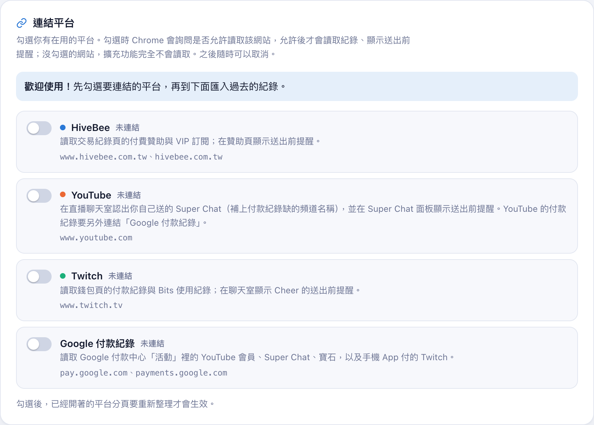
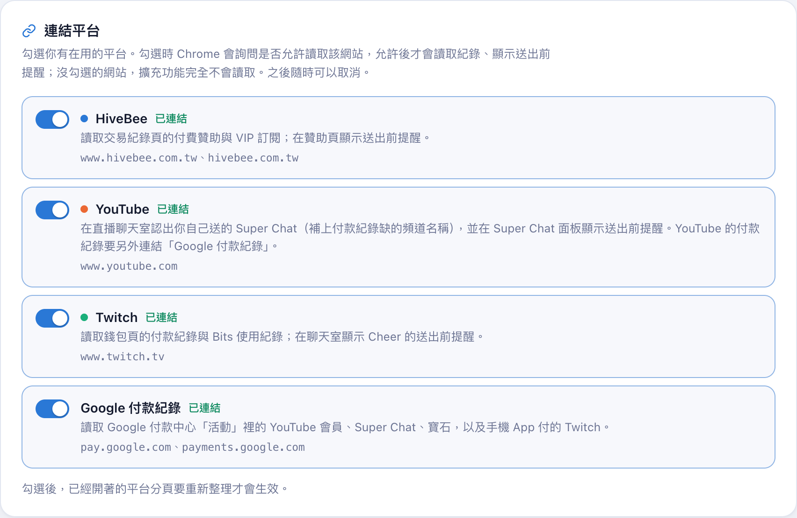
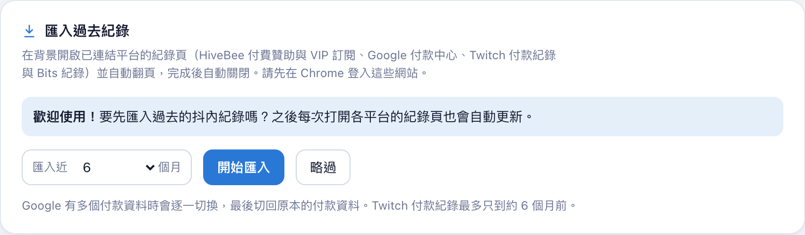
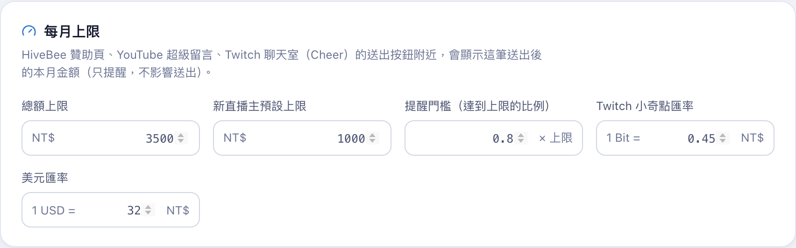
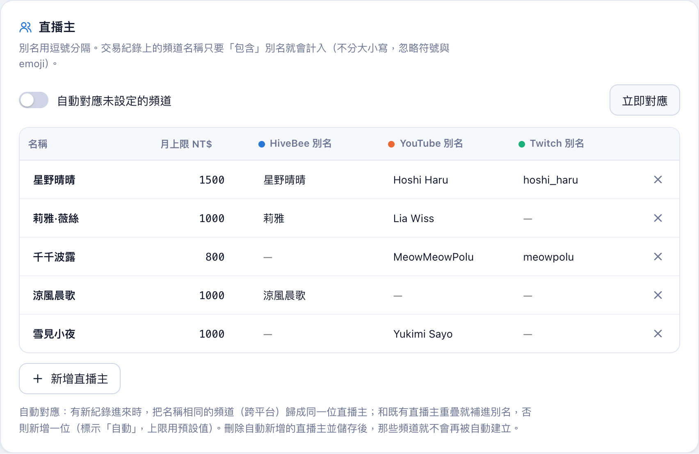
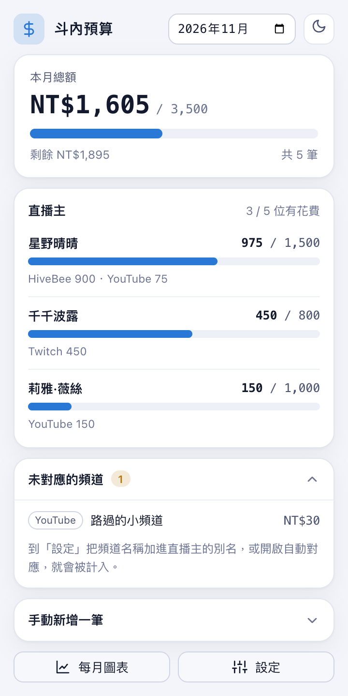
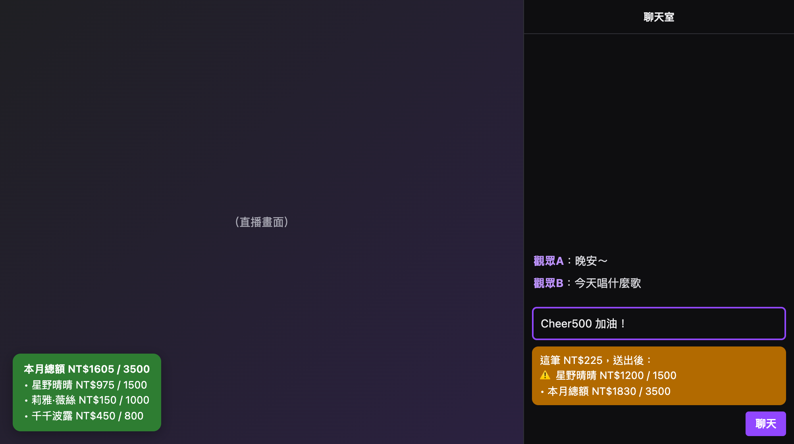
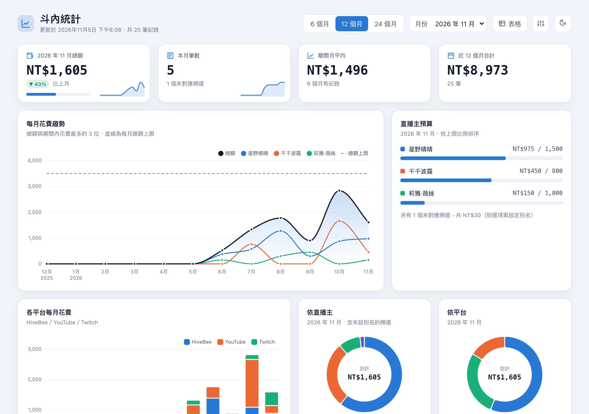
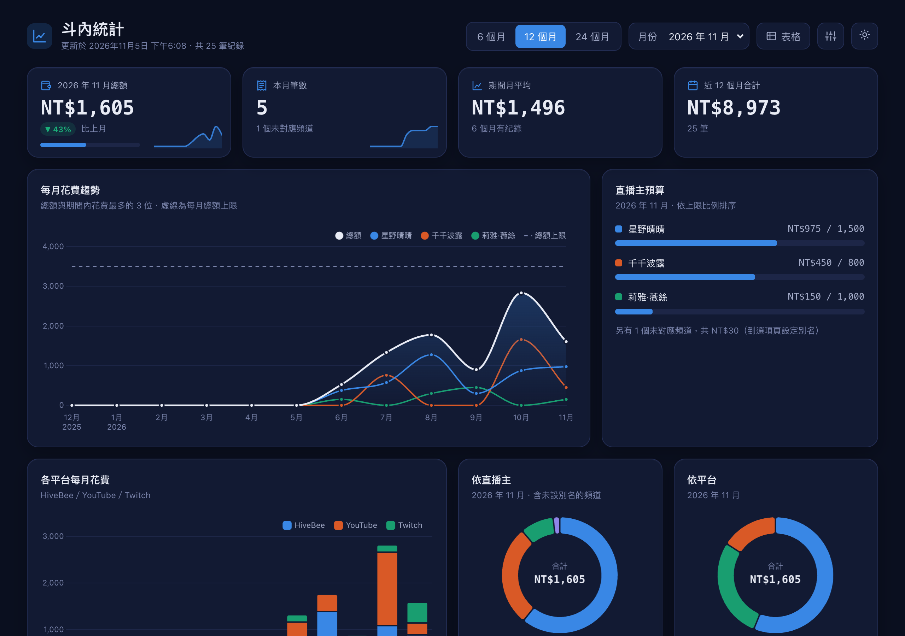
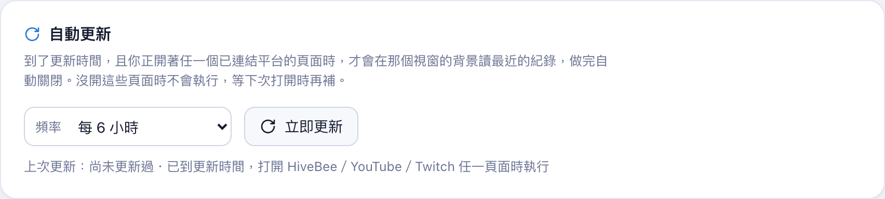

# 斗內預算管家 使用教學

斗內預算管家會整理你在 HiveBee、YouTube、Twitch 的斗內紀錄，算出每個月花在每位直播主身上的錢，接近或超過你設定的上限時提醒你。

所有資料只存在你自己的電腦，不會上傳到任何伺服器。

> 教學裡的直播主和金額都是虛構的示範資料。

## 目錄

1. [安裝](#1-安裝)
2. [連結平台](#2-連結平台)
3. [匯入過去紀錄](#3-匯入過去紀錄)
4. [設定每月上限](#4-設定每月上限)
5. [設定直播主](#5-設定直播主)
6. [每天看花費：彈出視窗](#6-每天看花費彈出視窗)
7. [送出前提醒](#7-送出前提醒)
8. [每月圖表](#8-每月圖表)
9. [自動更新](#9-自動更新)
10. [常見問題](#10-常見問題)

---

## 1. 安裝

1. 在 Chrome 網址列輸入 `chrome://extensions`，打開右上角的「開發人員模式」。
2. 按「載入未封裝項目」，選擇 `stream-budget` 資料夾。
3. 安裝完成後會自動打開設定頁。

建議把擴充功能釘選到工具列：按網址列右邊的拼圖圖示，在「斗內預算管家」旁邊按圖釘。

## 2. 連結平台

設定頁最上面是「連結平台」。第一次使用時全部都是「未連結」，擴充功能不會讀取任何網站。

**把你有在用的平台打開：**

1. 按平台左邊的開關。
2. Chrome 會跳出視窗，問你是否允許「斗內預算管家」讀取這個網站。按「允許」。
3. 狀態變成綠色的「已連結」就完成了。

每個平台會讀什麼：

| 項目 | 會做的事 |
|---|---|
| HiveBee | 讀交易紀錄頁的付費贊助與 VIP 訂閱；在贊助頁顯示送出前提醒 |
| YouTube | 在直播聊天室認出你自己送的 Super Chat；在 Super Chat 面板顯示送出前提醒 |
| Twitch | 讀錢包頁的付款紀錄與 Bits 使用紀錄；在聊天室顯示 Cheer 的送出前提醒 |
| Google 付款紀錄 | 讀 YouTube 會員、Super Chat、寶石，以及用手機 App 付的 Twitch |

**用 YouTube 的話，「YouTube」和「Google 付款紀錄」兩個都要連結。**YouTube 的付款紀錄在 Google 付款中心，不在 YouTube 網站上。

想取消時，把開關關掉就好，Chrome 會同時收回讀取那個網站的權限。

> 連結後，已經開著的平台分頁要重新整理一次才會生效。

## 3. 匯入過去紀錄

連結平台後，往下捲到「匯入過去紀錄」，選要匯入幾個月，按「開始匯入」。

- 擴充功能會在背景開啟各平台的紀錄頁，自動翻頁讀取，讀完自動關閉。只會開你有連結的平台。
- 開始前，請先在 Chrome 登入這些網站。
- 下方會顯示每個紀錄頁讀了幾筆、最舊讀到哪一天。
- Google 有多個付款資料時，會一個一個切換讀取，最後切回原本的付款資料。
- Twitch 的付款紀錄最多只能讀到大約 6 個月前。

## 4. 設定每月上限

| 欄位 | 說明 |
|---|---|
| 總額上限 | 每個月所有斗內加起來的上限 |
| 新直播主預設上限 | 新增直播主時，預設的每月上限 |
| 提醒門檻 | 花到上限的幾成時開始提醒。`0.8` 代表花到 80% 就提醒 |
| Twitch 小奇點匯率 | 1 個 Bit 等於多少台幣，請依你實際購買的價格調整 |
| 美元匯率 | Twitch 網頁付款多半是美元，用這個換算成台幣 |

改完記得按右下角的「儲存」。

## 5. 設定直播主

同一位直播主在不同平台的名稱常常不一樣，例如 YouTube 叫「Hoshi Haru」、Twitch 叫「hoshi_haru」。在「別名」欄填上各平台的名稱，紀錄就會算到同一個人身上。

- 多個別名用逗號分隔。
- 只要紀錄上的頻道名稱「包含」別名就算數，不分大小寫，也會忽略符號和 emoji。
- 每位直播主可以設定自己的每月上限。

**自動對應**：打開「自動對應未設定的頻道」後，有新紀錄進來時，名稱相同的頻道會自動歸成同一位直播主，標示「自動」。不想要的話，刪掉那位直播主並儲存，之後就不會再自動建立。

## 6. 每天看花費：彈出視窗

按工具列上的擴充功能圖示，就能看到本月的花費。

- **本月總額**：已花多少、上限多少、還剩多少。
- **直播主**：只列出本月有花費的直播主，花最多的排前面。接近上限時會標示「接近上限」，超過時標示「超過上限」。
- **未對應的頻道**：有紀錄、但還沒對應到任何直播主的頻道。到設定頁把它加進別名，就會算到那位直播主身上。
- **手動新增一筆**：記錄擴充功能讀不到的斗內，例如現場活動或其他平台。
- 右上角可以切換月份，也可以切換深淺色。

## 7. 送出前提醒

在連結的平台上準備斗內時，送出按鈕附近會顯示「這筆送出後，本月會變成多少」。

- 顏色代表送出後的狀態：綠色是還在預算內，橘色是接近上限，紅色是會超過上限。
- 只是提醒，不會擋住或改變送出，最後還是由你決定。
- 支援的地方：HiveBee 贊助頁、YouTube 的 Super Chat 面板、Twitch 聊天室（輸入框裡有 `Cheer100` 這類文字時）。
- 左下角的綠色框是本月狀態，點一下就會關閉。

## 8. 每月圖表

在彈出視窗按「每月圖表」，或在設定頁左下角按「每月圖表」。

- **上方四張卡片**：本月總額與上個月的比較、本月筆數、期間內每月平均、近 12 個月合計。
- **每月花費趨勢**：總額與花最多的 3 位直播主，虛線是每月總額上限。
- **直播主預算**：本月每位直播主花到上限的幾成。
- **各平台每月花費**、**依直播主**、**依平台**：看錢主要花在哪裡。
- 往下捲還有每日花費的日曆熱力圖，以及最近的交易紀錄。
- 右上角可以切換期間（6／12／24 個月）、月份，或改用表格檢視。

深色模式：

## 9. 自動更新

- 到了設定的更新時間，而且你正開著任一個已連結平台的頁面時，擴充功能會在那個視窗的背景讀最近的紀錄，讀完自動關閉。
- 沒開這些頁面時不會執行，等你下次打開時再補。
- 想馬上更新就按「立即更新」。

## 10. 常見問題

**Q：資料會上傳到哪裡嗎？**
不會。所有設定和紀錄只存在你這台電腦的 Chrome 裡。要換電腦時，用設定頁「資料」區塊的匯出、匯入。

**Q：為什麼某筆斗內沒有算到直播主身上？**
打開彈出視窗的「未對應的頻道」，把那個頻道名稱加進直播主的別名。網頁付的 YouTube Super Chat 在付款紀錄上沒有頻道名稱，要先連結「YouTube」，擴充功能才能從聊天室補上頻道。

**Q：連結平台時沒有跳出詢問視窗？**
可能之前按過「拒絕」。到 `chrome://extensions` → 斗內預算管家 →「詳細資料」→「網站存取權」，確認設定後，再回設定頁重新打開開關。

**Q：送出前提醒沒出現？**
確認該平台已連結，並重新整理頁面。Twitch 只認得 `Cheer100` 這類 Twitch 全站通用的 Cheer 寫法，頻道自訂的 Cheer 認不到。

**Q：可以只用其中一個平台嗎？**
可以。只連結你有在用的平台，其他平台的網站擴充功能完全不會讀取。
